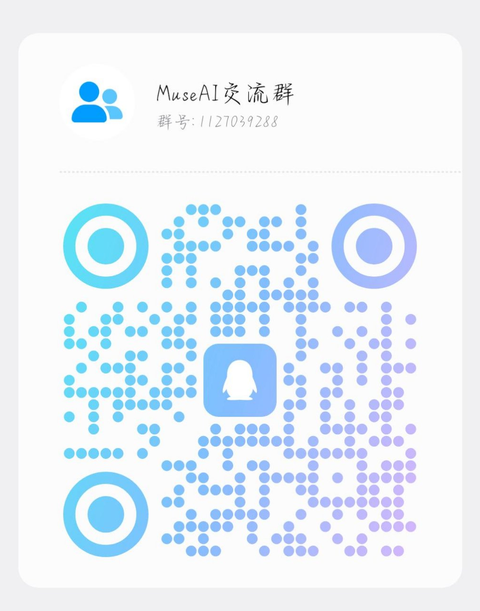

# 主题知识库框架模板


> 从真实知识库提炼的通用脚手架：**只含框架和规则约束文档，零原文内容**。
> Fork 后按 `SETUP.md` 十分钟搭出属于你自己的新主题知识库。

> 占位符说明：`{{THEME_NAME}}` = 你的主题名，`{{SOURCE}}` = 来源名。
> 全库搜索这两个占位符并替换，详见 `SETUP.md`。

## 四层架构

```
┌──────────────────┐
│   原文语料/       │  只存不改：原始材料，按命名规范存放
├──────────────────┤
│    知识库/        │  提炼后的精华：按主题/板块组织的知识文档
├──────────────────┤
│  索引与维护/      │  三层索引 ＋ 入库SOP ＋ 更新日志 ＋ 监控方法
├──────────────────┤
│     清单/         │  审计清单：语料完整性、补齐、体检
└──────────────────┘
     备用库/  ──  备选来源，独立目录，与主库隔离存放
```

数据只往一个方向流：**原文语料 → 提炼 → 知识库 → 索引**，任何时候都能从一条知识追溯回原文。

## 目录地图

| 目录 | 放什么 | 关键规则 |
|---|---|---|
| `原文语料/` | 原始材料（文章/笔记/书籍/转写） | 只存不改，按 `规则/语料命名规范.md` 命名 |
| `知识库/` | 提炼后的精华文档 | 用 `模板/提炼文档-模板.md`，每条知识标注来源 |
| `索引与维护/` | 总索引/主题索引/概念索引、SOP、更新日志 | 每次入库后同步更新索引 |
| `清单/` | 审计与体检清单 | 只记录状态，不存正文 |
| `备用库/` | 备选/待验证来源 | 独立隔离，检索时标注【备选库·仅作参考】，主备冲突以主库为准 |
| `规则/` | 8 份规则约束文档 | 建库先读，入库照做 |
| `模板/` | 6 份文档模板 | 复制后使用，不直接改模板 |
| `bin/` | 检索脚本 | `kb-search.sh` 通用关键词检索 |

## 规则一览

| 编号 | 文档 | 管什么 |
|---|---|---|
| KB-R001 | 规则/入库SOP.md | 入库七步＋质量门 |
| KB-R002 | 规则/索引规范.md | 三层索引的维护方法 |
| KB-R003 | 规则/原子条目规范.md | 知识原子的 ID 与映射表 |
| KB-R004 | 规则/语料命名规范.md | `{类型}__{来源}__{日期}.txt` |
| KB-R005 | 规则/主备库隔离规则.md | 备选来源的隔离与转正 |
| KB-R006 | 规则/更新日志规范.md | 按日期分节，只追加不改历史 |
| KB-R007 | 规则/检索规范.md | 三层检索＋来源标注 |
| KB-R008 | 规则/来源标注规范.md | 每条知识必须可追溯到原文 |

## 设计原则（详见 `框架总纲.md`）

1. **原件只存不改** —— 原文语料一旦入库永不编辑，勘误另存新文件。
2. **提炼与原文分离** —— 精华进 `知识库/`，原文留 `原文语料/`，用来源标注连接。
3. **索引与内容同步** —— 每次入库必须更新三层索引，无索引的内容视为未入库。
4. **主备隔离** —— 备选来源独立存放，检索标注来源，冲突以主库为准。
5. **来源可追溯** —— 每条知识都能一路找到原文文件。
6. **增量演进** —— 周整理、月复盘、季升级；格式预留向量化可能。

## 快速开始

👉 先读 `SETUP.md`，跟着走完 6 步。

## 💬 交流群

扫码加入 QQ 交流群（群号：1127039288），一起聊知识库搭建、AI 玩法：



## 👤 模板作者

**liyu**（GitHub: [@juliasadler](https://github.com/juliasadler)）
本模板从两个长期维护的真实主题知识库（四层架构＋入库 SOP＋三层索引）提炼，规则文档全部为通用框架版。

## 📄 许可证

本仓库模板内容采用 [MIT License](LICENSE)。
用本模板搭建你自己的知识库后，新仓库的许可证由你自己决定。
